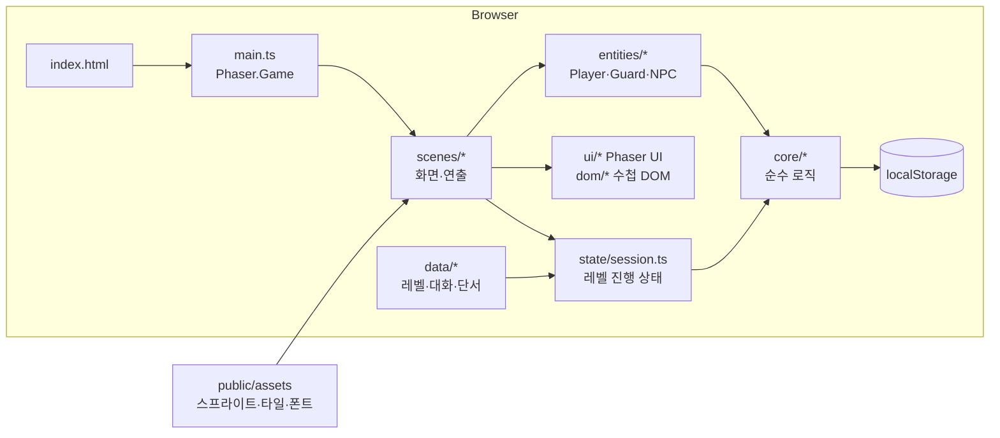
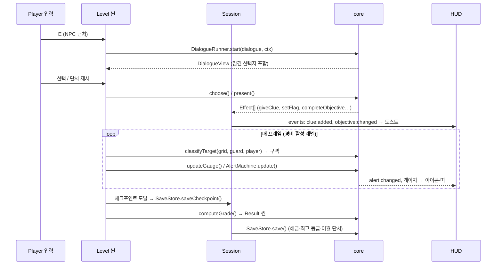

# 기본 설계서 — 「코드네임 모스」

| 항목 | 내용 |
|---|---|
| 문서 버전 | v1.0 (2026-10-18) |
| 작성 | 리드 |
| 관련 | [01_요구사항정의서](01_요구사항정의서.md) · [03_화면설계서](03_화면설계서.md) · [04_상세설계서](04_상세설계서.md) · [06_테스트계획서](06_테스트계획서.md) · [07_조사보고서](07_조사보고서.md) |

---

## 1. 시스템 개요

브라우저에서 실행되는 **정적 웹 게임**이다. 서버·DB·로그인이 없고, 진행 상황은 브라우저 `localStorage`에 저장한다.



**핵심 원칙: 로직과 표현을 나눈다.**
- `src/core/` = 시야 판정, 감지 게이지, 경보 상태 머신, 대화 진행, 단서, 길찾기, 자물쇠, 저장, 등급. **Phaser를 import하지 않는** 순수 TypeScript라서 Vitest로 바로 테스트한다.
- `src/scenes/`, `src/entities/`, `src/ui/` = Phaser로 그리고 입력을 받는 쪽. 판단은 core에 맡긴다.
- `src/data/` = 레벨·대화·단서는 코드가 아니라 데이터. 레벨을 추가할 때 엔진 코드를 고치지 않는다(NFR-07).

---

## 2. 기술 선정 (ADR)

| # | 결정 | 버전(고정) | 비교한 후보 | 이유 |
|---|---|---|---|---|
| ADR-01 | 게임 엔진 **Phaser 4** | `phaser@4.2.1` (2026-07-09) | Phaser 3.90, Unity, Godot | 웹 2D 전용·경량. 사용 기능(Tilemap·Arcade·Scene·Input·Tween)은 v4에서 파괴적 변경 없음. 3.90은 2025-05 이후 릴리스 없음. Unity/Godot은 사용자와 논의 후 웹+TS로 결정 |
| ADR-02 | 언어 **TypeScript 6** | `typescript@6.0.3` | TS 7.0.2 | TS 7은 typescript-eslint(peer `<6.1.0`)·프로그래매틱 API 미지원 |
| ADR-03 | 빌드 **Vite** | `vite@8.3.2` | 8.3.4 | 8.3.4는 릴리스 2주 미만(10-08) → 규칙상 제외 |
| ADR-04 | 테스트 **Vitest + Playwright** | `vitest@5.0.3`, `@playwright/test@1.63.0` | Jest | Vite 설정 공유, ESM 네이티브 |
| ADR-05 | 린트 **ESLint flat + typescript-eslint + Prettier** | `eslint@10.12.0`, `@eslint/js@10.0.1`, `typescript-eslint@8.71.0`, `prettier@3.9.9` | — | eslint-config-prettier는 1년 이상 미갱신이라 제외(포맷 규칙 미사용으로 충돌 없음) |
| ADR-06 | 대화 **자체 JSON(TS 데이터) + DialogueRunner** | — | inkjs 2.4.0, Yarn Spinner | 필요 기능(단서 조건·제시·코드 입력)이 작고 타입 검증이 쉬움. 대사량이 커지면 inkjs 재검토 |
| ADR-07 | 시야 **자체 레이캐스트(그리드 DDA)** | — | phaser-raycaster 0.11.1 | 사용자 적음, 로직을 core로 분리해 테스트하려면 자체 구현이 유리 |
| ADR-08 | 길찾기 **자체 그리드 A\*** | — | easystarjs, navmesh, pathfinding | 후보 모두 장기 방치(2016~2021). 맵이 40×30으로 작아 단순 A*로 충분 |
| ADR-09 | 맵 **ASCII 그리드(TS 데이터) → 런타임 Tilemap 생성** | — | Tiled `.tmj` | 텍스트라 리뷰·diff·자동 검증(도달 가능성 등)이 쉽고 에디터 설치가 필요 없음. Phaser `make.tilemap({ data })` 사용 |
| ADR-10 | 아트 **LPC 32px**(캐릭터는 Universal LPC 레이어 합성) — *승인 단계에서 확정* | — | Kenney CC0 16px, LimeZu(무료판 상업 금지) | NPC마다 다른 외형 + 4방향 걷기. CC-BY-SA/GPL → 저자 크레딧 필수, 수정 아트는 같은 라이선스 공개(공개 저장소라 문제없음) |
| ADR-11 | 폰트 **Galmuri** | `galmuri@2.40.3` (OFL-1.1) | NeoDunggeunmo | 한글 픽셀 폰트, 7/9/11/14px. woff2를 `public/assets/fonts`에 셀프호스팅 |
| ADR-12 | 수첩·설정 UI는 **DOM 오버레이**, 나머지는 Phaser | — | 전부 Phaser | 스크롤·긴 한글 줄바꿈 처리 |

> [!warning] 미검증
> Phaser 4 API 세부(마스크 `filters.internal.addMask()`, `roundPixels` 기본값 등)는 조사 B의 마이그레이션 가이드 요약에 근거한다. 토대 단계에서 실제 동작으로 확인한다.

---

## 3. 실행 환경·화면

- 기준 해상도 **640×360**, 정수 배율(×1/×2/×3) 확대 + 레터박스. `pixelArt: true`, `roundPixels: true`.
- 타일 32px, 캐릭터 프레임 64×64. 카메라는 플레이어를 따라가고 맵 경계에서 멈춘다.
- 대상 브라우저: 최신 Chrome·Edge·Firefox 데스크톱(NFR-03).

---

## 4. 씬 구성

| 씬 키 | 역할 | 함께 떠 있는 씬 |
|---|---|---|
| `Boot` | 폰트 로드(`document.fonts.load`), 에셋 preload, 세이브 검증 | — |
| `Title` | 새 게임 / 이어하기 / 크레딧 | — |
| `LevelSelect` | 레벨 카드 L1~L3, 잠금·최고 등급 | — |
| `Briefing` | 국장 대화 + 임무 서류 + 새 능력 안내 | `Dialogue` |
| `Level` | 맵·플레이어·NPC·경비. 조사/잠입은 **phase**로 구분(씬 분리 안 함) | `HUD`, 필요 시 `Dialogue`·`Lockpick`·`Pause` |
| `HUD` | 경보 띠, 목표, 노출도, 능력 바, 토스트 | `Level`과 병렬 |
| `Dialogue` | 대화창 오버레이(제시 모드에서 DOM 수첩 호출) | `Level`/`Briefing` 위 |
| `Lockpick` | 자물쇠 미니게임 오버레이(월드는 계속 움직임) | `Level` 위 |
| `Pause` | 일시정지 메뉴 | `Level` 정지 |
| `Result` | 통계·등급·능력 해금 카드 | — |
| `Credits` | 에셋·폰트 크레딧, L3 엔딩 후 | — |

```mermaid
stateDiagram-v2
  [*] --> Boot --> Title
  Title --> LevelSelect
  Title --> Credits
  LevelSelect --> Briefing
  Briefing --> Level
  Level --> Result: 탈출 / 접선 성공
  Level --> LevelSelect: 임무 포기
  Level --> Level: 붙잡힘 → 체크포인트
  Result --> Briefing: 다음 임무
  Result --> LevelSelect
  Result --> Credits: L3 클리어
  Credits --> Title
```

---

## 5. 폴더 구조와 담당 범위

```
spy-game/
├─ index.html
├─ package.json · tsconfig.json · vite.config.ts · vitest.config.ts
├─ playwright.config.ts · eslint.config.js · .prettierrc · .gitignore
├─ README.md
├─ docs/                         설계 문서 (리드)
├─ public/assets/
│  ├─ characters/<charId>.png    LPC 합성 스프라이트 시트
│  ├─ tiles/<tileset>.png        32px 타일셋
│  ├─ ui/                        9-slice 패널, 아이콘
│  ├─ fonts/                     Galmuri woff2
│  └─ CREDITS.md                 저자·라이선스
├─ tools/                        에셋 합성·검증 스크립트 (Node)
├─ src/
│  ├─ main.ts                    Phaser.Game 생성
│  ├─ config.ts                  해상도·타일 크기·조정값(튜닝 상수)
│  ├─ types/                     ★ 계약(공유 타입)
│  ├─ core/                      순수 로직 (Phaser import 금지)
│  ├─ data/                      clues · abilities · characters · levels/ · dialogues/ · strings
│  ├─ state/                     session(레벨 진행 상태), events(EventBus)
│  ├─ input/bindings.ts          키 바인딩 테이블
│  ├─ scenes/                    씬
│  ├─ entities/                  Player · Guard · Npc · Interactable
│  ├─ ui/                        Phaser UI 컴포넌트
│  ├─ dom/                       ClueNotebook (DOM)
│  └─ debug/testApi.ts           E2E용 window.__spy (개발·테스트 모드에서만)
└─ tests/
   ├─ unit/                      Vitest
   └─ e2e/                       Playwright
```

**담당 범위** (구현 단계에서 각 담당은 자기 범위 밖 파일을 수정하지 않는다. 계약 변경이 필요하면 리드에게 보고)

| 담당 | 편집 가능 | 비고 |
|---|---|---|
| 리드 | `src/types/**`, `src/config.ts`, 설정 파일, `docs/**`, `README.md` | 계약 소유자 |
| 코어 로직 | `src/core/**` | 04 §3의 API 시그니처를 그대로 구현 |
| 프론트엔드 | `src/main.ts`, `src/scenes/**`, `src/entities/**`, `src/ui/**`, `src/dom/**`, `src/state/**`, `src/input/**`, `src/debug/**`, `index.html`, `src/styles.css` | core가 늦으면 시그니처 기준 스텁으로 진행 |
| 콘텐츠·에셋 | `src/data/**`, `public/assets/**`, `tools/**` | 05_레벨설계서를 데이터로 변환 |
| 테스터 | `tests/**` | 구현 코드를 보지 않고 01(AC)·04(계약)만으로 작성 |

---

## 6. 데이터 흐름 (레벨 1회 플레이)



---

## 7. 저장 설계 요약
- `spyGame.save.v1` — 해금 레벨, 최고 등급, 이월 단서, 설정
- `spyGame.save.v1.bak` — 직전 정상 세이브 백업
- `spyGame.checkpoint.v1` — 진행 중 레벨의 체크포인트
- 손상·버전 불일치 → 백업 복구 시도 → 실패 시 기본값 + 1회 안내. localStorage 접근 불가 → 메모리 저장으로 진행 + 경고.
- 형식은 04_상세설계서 §6.

---

## 8. 비기능 대응

| NFR | 설계 대응 |
|---|---|
| 성능(60fps) | 원뿔 레이 수 32개, 경비 최대 6명. 레이캐스트는 그리드 DDA(O(거리)). 프로파일링 후 레이 수 조정 |
| 로딩 | 캐릭터 시트는 걷기 행만 잘라 저장(시트 축소), 타일셋은 레벨별 1장 |
| 라이선스 | `tools/`의 합성 스크립트가 사용 레이어 목록으로 `CREDITS.md`를 자동 생성 |
| 텔레메트리 없음 | 공식 템플릿을 쓰지 않고 직접 구성(템플릿의 `log.js` 배제) |
| 테스트 가능성 | core 순수 함수화, `window.__spy` 테스트 API로 E2E에서 상태 조회·조작 |

---

## 9. 빌드·실행 명령

| 명령 | 내용 |
|---|---|
| `npm install` | 의존성 설치(버전 고정, `package-lock.json` 커밋) |
| `npm run dev` | 개발 서버 (http://localhost:5173) |
| `npm run build` | `tsc --noEmit` 후 `vite build` → `dist/` |
| `npm run preview` | 빌드 결과 미리보기 |
| `npm run lint` / `npm run format` | ESLint / Prettier |
| `npm run typecheck` | `tsc --noEmit` |
| `npm test` | Vitest 단위 테스트 |
| `npm run test:e2e` | Playwright (dev 서버 자동 기동) |
