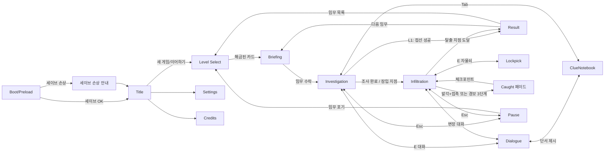

# 화면 설계서 — 「코드네임 모스」

| 항목 | 내용 |
|---|---|
| 문서 버전 | v1.0 (2026-10-18) |
| 작성 | 디자인(kaihatsu-designer) 초안 → 리드 정리 |
| 근거 | [07_조사보고서](07_조사보고서.md) ([A] = UX 조사, [B] = 기술 조사) |
| 관련 | [01_요구사항정의서](01_요구사항정의서.md), [05_레벨설계서](05_레벨설계서.md) |

- 콘셉트: **"60년대 첩보영화 오프닝 크레딧"**. 미드나잇 네이비 바탕 + 머스터드·틸·버밀리언 포인트, 서류철과 극비 도장, 아이리스 와이프 전환. 가볍고 세련된 톤.
- 표기: "(결정)" = 이 문서에서 확정한 디자인 결정, "(추론)" = 출처 없는 판단. 수치는 플레이테스트로 조정.

> [!important] 리드 정리 — 요구사항정의서와 다른 부분은 아래가 우선한다
> | 항목 | 확정 내용 |
> |---|---|
> | 와이어프레임 속 이름·문구 | **예시**다. 실제 인물·단서·임무명은 [05_레벨설계서](05_레벨설계서.md)를 따른다(타이틀 = "코드네임 모스", 대사 = 오스왈드 크레인 등) |
> | 키 리맵 UI | **MVP 제외**. 코드는 바인딩 테이블(`src/input/bindings.ts`)로 분리만 한다 (01 §8) |
> | 웅크리기 키 | C(토글) / Shift(누르는 동안) |
> | 능력 키 | 동전 = G(누르고 조준) + 좌클릭, 자물쇠 = 잠긴 문에서 E → Space. 능력 바에는 이 키를 라벨로 표시. 숫자 1~4는 선택지 전용 |
> | 자물쇠 수치 | AC-43/44를 따른다: 1.2초 주기, 성공 구간 18% 고정(위치만 바뀜), 실패 시 소음 6타일, 진행 핀 0으로 리셋 |
> | 조사/잠입 화면 | S4·S5는 별도 씬이 아니라 **같은 `LevelScene`의 단계(phase)**. 경비가 활성화되면 잠입 HUD(경보 띠·노출도)가 나타난다 |
> | 세이브 백업 | 직전 정상 세이브 1개를 `spyGame.save.v1.bak`에 보관(04_상세설계서 §6) |

---

## 0. 렌더링 기준 (결정)

| 항목 | 값 |
|---|---|
| 기준 해상도 | **640×360** (16:9). 1280×720에서 ×2, 1920×1080에서 ×3 **정수 배율**. 남는 영역은 `bg.void` 레터박스 |
| Phaser 설정 | `pixelArt: true`, `roundPixels: true`(v4는 기본값 false라 명시해야 함 [B]), `scale.mode: FIT` 대신 **직접 정수 배율 계산**(`Math.floor(min(w/640, h/360))`, 최소 1) + `autoCenter` |
| 타일/캐릭터 | 32px 타일 → 화면당 20×11.25타일. 캐릭터 64×64 프레임(실제 몸은 약 32×48). 카메라 줌 1 고정 |
| 폰트 | Galmuri 7/9/11/14를 **설계 크기 그대로만** 사용(중간 크기·소수 배율 금지). `document.fonts.load()` 완료 후 Scene 시작 [B] |
| DOM 오버레이 (권장) | **ClueNotebook과 Settings만 DOM**으로 만든다. 스크롤, 긴 한글 줄바꿈, 키 리맵 입력, 스크린리더 지원 때문이다. 캔버스 위 `#ui-root`에 `transform: scale(N)`(캔버스와 같은 정수 N), `image-rendering: pixelated`, `-webkit-font-smoothing: none`을 준다. 대화창·HUD·미니게임은 **Phaser 안에서** 그린다(타이밍, 연출 일관성) |
| 씬 구조 | `GameScene`(월드) + 병렬 `HUDScene` + 오버레이 `DialogueScene`/`LockpickScene`/`PauseScene`. 오버레이를 띄우면 GameScene은 `pause()` |

---

## 1. 화면 목록과 전환

| ID | 화면 | 비고 |
|---|---|---|
| S0 | Boot/Preload | 폰트·아틀라스 로드, 세이브 검증 |
| S1 | Title | 새 게임 / 이어하기 / 설정 / 크레딧 |
| S2 | Level Select | 서류철 카드 L1~L3 |
| S3 | Briefing | 임무 서류 + 상관 대화 + 목표 |
| S4 | Investigation | 자유 이동, NPC 대화, 단서 수집 (L1은 이 단계가 중심) |
| S5 | Infiltration | 잠입 HUD (L2부터 경비 감지) |
| O1 | Dialogue | S3/S4/S5 위에 뜨는 오버레이 |
| O2 | ClueNotebook (DOM) | 어디서나 Tab. 대화 중에는 "제시" 모드 |
| O3 | Lockpick | S5 오버레이 |
| O4 | Pause / Settings | Esc로 언제든 |
| S6 | Caught → Checkpoint | 페이드 연출(씬이 아니라 GameScene 내부 상태) |
| S7 | Result | 등급·통계·능력 해금 카드 |
| S8 | Credits | LPC/OGA/Galmuri 크레딧 [B] |



전환 연출 (결정)
- 씬 사이: **아이리스 와이프**(원형 마스크 축소→확대, 각 200ms). 첩보영화 오프닝을 오마주한다. v4는 `filters` 마스크를 쓴다 [B].
- 오버레이: 120ms 슬라이드+페이드. 체크포인트: 아래 6절 참고.

---

## 2. 화면별 레이아웃 (640×360, ASCII 1칸 ≈ 10px 가로 / 1줄 ≈ 20px 세로)

### S1 Title
```
+----------------------------------------------------------------+
|  (배경: 항구 야경 패럴랙스, 서치라이트가 천천히 스윕)                  |
|                                                                |
|        ███ 코드네임 모스 ███        <- 14px, mustard, 그림자       |
|        - A SPY IN THE PORT CITY -     <- 9px, text.dim           |
|                                                                |
|                  > 이어하기                                      |
|                    새 게임                                       |
|                    설정                                          |
|                    크레딧                                        |
|                                                     v0.1  7px  |
+----------------------------------------------------------------+
```
- 메뉴: ↑↓/W·S, Enter/Space, 마우스 호버. 선택 항목 앞 `>` + mustard 밑줄.
- 이어하기는 세이브가 없으면 회색. "새 게임"을 고르면 세이브가 있을 때 "기존 기록을 덮어씁니다" 확인창을 띄운다.

### S2 Level Select
```
+----------------------------------------------------------------+
| 임무 목록                                   보유 능력: [대화][숨기]  |
|                                                                |
|  +--------------+   +--------------+   +--------------+          |
|  | [사진:카페]    |   | [사진:대사관]   |   | ▒▒▒▒▒▒▒▒▒▒▒▒ |          |
|  | 01 항구 카페   |   | 02 대사관 파티  |   | 🔒 03 ???     |          |
|  | 등급: A       |   | 등급: -        |   | 02 완료 시 해금 |          |
|  | [극비 도장]    |   |                |   |              |          |
|  +--------------+   +--------------+   +--------------+          |
|        ^ 선택(mustard 테두리 + 2px 위로)                          |
| ←→ 선택   Enter 브리핑   Esc 타이틀                                |
+----------------------------------------------------------------+
```
- 카드 160×200, 간격 24. 클리어 카드에는 최고 등급 도장(빨간 회전 -8°).

### S3 Briefing
```
+----------------------------------------------------------------+
| +---------------- 서류철 (cream paper) ----------------------+  |
| | TOP SECRET [도장]        임무 02: 대사관 파티               |  |
| | [대사 초상 48x48]  대상: 마르코 대사                        |  |
| | 목표 ① 금고 위치 파악  ② 서류 촬영  ③ 탈출                  |  |
| | 정보: · 파티 시작 21:00  · 경비 4명 (정지 2, 순찰 2)          |  |
| |       · 초대장은 바텐더가 관리한다고 함 (단서로 등록됨)          |  |
| +-----------------------------------------------------------+  |
| [상관 초상] 국장: "이번엔 들키면 끝이야. ...▼"   <- DialogueBox 재사용 |
|                     [ 임무 수락 Enter ]   [ 목록으로 Esc ]          |
+----------------------------------------------------------------+
```
- 브리핑 대사가 끝나야 수락 버튼이 활성화된다. 브리핑에서 받은 정보는 자동으로 단서 카드가 된다(토스트 표시).

### S4 Investigation / S5 Infiltration 공통 월드 + HUD
```
+----------------------------------------------------------------+
|[경보 띠: 평시 ○]                                 [수첩 Tab] (●2) |  y=0~16
|  목표 ▸ 바텐더에게 초대장 얻기                                      |  y=20 9px
|                                                                |
|           (월드: 32px 타일, 경비 원뿔, NPC)        ➤ 12m           |  가장자리 목표 화살표
|                    ?                                           |
|                 [경비]◢◤◢◤ 원뿔                                  |
|        [주인공]                                                 |
|                                                                |
| [노출도 눈 아이콘]                       [E 숨기]  <- 상호작용 힌트  |
| ◉ 보임                    [1 동전 x3][2 자물쇠][Shift 웅크리기]      |  y=332~356
+----------------------------------------------------------------+
```
- S4(조사)에서는 경보 띠·노출도를 숨기고 목표·수첩만 보인다. 경비가 없으므로 필요 없다 [A].

### O1 Dialogue (하단 1/3)
```
+----------------------------------------------------------------+
|                         (월드, 30% 어둡게)                         |
|  +----------+                                                  |
|  | 초상 64x64 |  <- 화자 쪽에 배치, 말하는 쪽만 밝게                   |
|  +----------+-------------------------------------------------+|
|  | 바텐더 루카  (11 Bold, accent)                               ||
|  | "초대장? 그런 건 아무한테나 주는 게 아니에요."▌                     ||
|  |  1. 칵테일을 주문한다                                         ||
|  |  2. 마르코 대사의 친구라고 한다                                 ||
|  |  3. ░░[단서 필요: 대사의 와인 취향]░░  (회색 + 자물쇠)            ||
|  |                                    [단서 제시 Tab]  ▼ Space  ||
|  +-------------------------------------------------------------+|
+----------------------------------------------------------------+
```
- 대화창: x=8, y=232, 624×120. 초상 64×64(LPC 머리 부분 2배 확대 크롭)를 창 위에 겹친다.
- 입력: Space/Enter/좌클릭 = 타이핑 스킵 → 다음. 선택지 1~4 숫자 키, ↑↓+Enter. 잠긴 선택지를 고르면 흔들림(80ms)과 함께 "수첩에서 단서를 찾아보세요" 힌트를 띄운다. Tab/"단서 제시" = 수첩을 제시 모드로 연다. 대화 로그는 L 또는 마우스 휠 업.
- 이미 고른 선택지는 text.dim + `✓`. 스포일러가 되는 선택지는 숨긴다 [A].

### O2 ClueNotebook (DOM)
```
+----------------------------------------------------------------+
| ┌ 단서 수첩 ─────────────── [인물] [문서] [물건] ── ✕ Esc ┐         |
| │ ┌────┐ ┌────┐ ┌────┐ ┌────┐   │ 상세                     │     |
| │ │초상 │ │초상 │ │ ?  │ │NEW │   │ [카드 확대]                │     |
| │ │루카 │ │마르코│ │    │ │초대장│ │ 마르코 대사                │     |
| │ │2/3 │ │1/3 │ │    │ │    │   │ · 보르도 와인만 마신다        │     |
| │ └────┘ └────┘ └────┘ └────┘   │ · ??? (미확인)             │     |
| │                              │ 출처: 바텐더 루카             │     |
| │                              │    [ 이 단서 제시 Enter ]     │     |
| └──────────────────────────────┴───────────────────────────┘     |
+----------------------------------------------------------------+
```
- 탭 3개(인물/문서/물건) + 4열 카드 그리드 + 우측 상세 패널(240px). 인물 카드는 알아낸 정보가 n/3이면 초상이 실루엣에서 선명해지는 3단계로 바뀐다(Obra Dinn식) [A].
- 제시 모드: 상단에 "누구에게: 루카" 띠가 붙고 상세 패널에 "제시" 버튼이 나온다. 맞지 않는 단서를 제시해도 처벌하지 않고 NPC가 반응 대사만 한다(Ace Attorney의 추궁처럼 관대하게) [A].
- 입력: ←→↑↓ 카드 이동, Q/E 탭 전환, Enter 제시/확대, Esc 닫기.

### O3 Lockpick (중앙 모달 240×120)
```
        +------------------------------------+
        |  자물쇠  ● ● ○   (핀 3개 중 2 성공)    |
        |  |------[■■]-------------▲-------|   |  <- 커서 왕복, ■ = 성공 구간
        |  Space 맞추기   Esc 그만두기          |
        +------------------------------------+
```
- 핀마다 커서가 왕복하는 막대가 하나씩 있다. 성공 구간은 핀이 진행될수록 좁아진다(24→16→12px). 실패하면 핀이 하나 리셋되고 **NoiseRing(반경 3타일)**이 생긴다. 전체 5초 안팎 [A].
- 월드는 멈추지 않는다(긴장감 유지). 대신 모달 뒤 월드를 50% 어둡게 하고 가장 가까운 경비 방향 표시를 남긴다(결정).

### O4 Pause
- 중앙 패널 200×180: 계속(Esc) / 수첩 / 설정 / 체크포인트에서 재시작 / 임무 포기. 일시정지는 **모든 게임 씬에서 언제든** 가능하다(미니게임 포함).

### S7 Result
```
+----------------------------------------------------------------+
| 임무 완료: 대사관 파티                                             |
|  +------------------+       발각 횟수     1        ✓ 0회면 보너스  |
|  |    [ A ] 도장     |       단서 수집     5/6                     |
|  |  (쾅! 스탬프 연출)  |       소요 시간     07:42                   |
|  +------------------+       체크포인트 복귀 0                       |
|  ───────────────── 새 능력 ─────────────────                     |
|          [AbilityUnlockCard: 동전 던지기  (뒤집히며 등장)]          |
|               [ 다음 임무 Enter ]  [ 임무 목록 Esc ]                |
+----------------------------------------------------------------+
```
- 연출 순서: 통계가 한 줄씩 카운트업(각 250ms) → 등급 도장이 쾅(스케일 2→1, 120ms, 카메라 흔들림 2px) → 해금 카드가 뒤집힘(400ms). 아무 키나 누르면 연출을 건너뛴다.

---

## 3. 잠입 HUD (결정)

| 요소 | 위치 | 내용 |
|---|---|---|
| 경보 띠 (Alert Band) | 상단 전체 폭 16px | 레벨 전역 상태 5단계. 색 + **아이콘 모양 + 글자**를 함께 쓴다. 수색·주의 단계는 남은 시간 막대를 표시 |
| 목표 트래커 | 좌상단 y=20, 최대 폭 280px | 현재 목표 1줄(9px) + 하위 목표 체크박스(최대 3). 갱신되면 mustard로 깜빡임(300ms ×2) |
| 목표 화살표 | 화면 가장자리 | 목표가 화면 밖에 있을 때만 화살표와 거리(m)를 표시. 조사 단계에서는 "대화할 사람" 머리 위에 💬 마커 [A] |
| 노출도 아이콘 | 좌하단 24×24 | 눈 3상태: **감은 눈(숨음)**, 반쯤 뜬 눈(빗금 원뿔 안에서 웅크림 = 안전), **뜬 눈 + 테두리 깜빡임(보이는 중)**. 옆에 9px 글자 "숨음/안전/노출" (Thief의 Light Gem 역할) [A] |
| 능력 바 | 우하단 | **해금된 능력만** 슬롯으로 표시. 슬롯 28×28, 키 라벨(7px), 개수/쿨다운 표시. 사용할 수 없으면 반투명 |
| 수첩 버튼 | 우상단 | 새 단서가 생기면 빨간 배지와 개수 |
| 상호작용 힌트 | 대상 위 월드 좌표 | `[E] 숨기` 7px 말풍선, 대상 외곽선 1px mustard |
| 미니맵 | **넣지 않음** | 조우 공간이 "한 화면 + 0.5~0.75 화면" 규모라 미니맵의 이득이 적고 HUD만 복잡해진다 [A]. 대신 브리핑과 수첩 '문서' 탭에 **층 평면도 카드**를 둔다(L3) |

- 경비 개인 표시: 머리 위 AlertIcon + 감지 미터(아이콘 아래 16×3px 막대). 화면 밖 경비가 주인공을 감지하는 중이면 해당 방향 가장자리에 `!` 쐐기를 표시한다.
- 숨은 상태: 주인공 스프라이트를 실루엣(`ink` 70%) + 1px 틸 외곽선으로 바꾸고 화면에 비네팅(가장자리 어둡게 20%)을 건다 [A].

---

## 4. 디자인 토큰

### 4.1 색 (60년대 첩보 팔레트 + 상태색은 Okabe-Ito 계열로 색각 이상 대응)
| 토큰 | Hex | 역할 |
|---|---|---|
| `bg.void` | `#0E1024` | 레터박스, 페이드 |
| `bg.deep` | `#1B1F3B` | 메뉴 배경(미드나잇 네이비) |
| `panel.glass` | `#232849` (α 0.92) | 대화창, HUD 패널 |
| `panel.line` | `#3BB5A8` | 패널 안쪽 1px 라인(틸) |
| `paper` | `#F2E8CF` | 서류철, 수첩, 카드 |
| `paper.shade` | `#D9C9A3` | 종이 그림자·구분선 |
| `ink` | `#2A2335` | 종이 위 글자 |
| `text` | `#F4ECD8` | 어두운 배경 위 본문 |
| `text.dim` | `#9C97B5` | 보조 글자, 비활성, 고른 선택지 |
| `text.locked` | `#6B6788` | 잠긴 선택지 |
| `accent` | `#E3B341` | 선택·강조·제목(머스터드) |
| `accent.2` | `#3BB5A8` | 링크·정보·화자 이름(틸) |
| `stamp` | `#C8323C` | 극비 도장, 등급 도장 |
| `safe` | `#56B4E9` | 안전·숨음(하늘색, 초록 사용 안 함) |
| `suspicion` | `#E69F00` | 의심·주의(주황) |
| `danger` | `#D55E00` | 경보·발각(버밀리언) |
| `cone.base` | `#F0E442` α 0.26 + 외곽선 α 0.8 | 밝은 구역(즉시 감지) |
| `cone.hatch` | `#F0E442` α 0.10 + 빗금 1px α 0.45(4px 간격 45°) | 빗금 구역(웅크리면 안전) |
| `cone.suspicious` | `#E69F00` α 0.30 | 의심 상태 경비의 원뿔 |
| `cone.alert` | `#D55E00` α 0.34 + **점선 외곽선** | 경보 상태 경비의 원뿔 |
| `noise` | `#FFFFFF` α 0.6 링 → 0 | 소음 원 |
| `hide.spot` | `#56B4E9` α 0.25 + 모서리 꺾쇠 | 은신처 표시 |

### 4.2 타이포 (Galmuri, 기준 해상도 px)
| 토큰 | 폰트 | 줄 높이 | 용도 |
|---|---|---|---|
| `t.title` | Galmuri14 | 20 | 화면 제목, 결과 등급 라벨 |
| `t.body` | Galmuri11 | 16 | 대화 본문, 선택지, 메뉴 |
| `t.name` | Galmuri11-Bold | 16 | 화자 이름, 카드 제목 |
| `t.small` | Galmuri9 | 12 | HUD 목표, 수첩 상세, 통계 |
| `t.tag` | Galmuri7 | 10 | 키 힌트, 버전, 배지 숫자 |
| `t.mono` | GalmuriMono9 | 12 | 시간·카운터(숫자가 흔들리지 않게) |
- 글자는 항상 정수 좌표에 놓는다. 그림자는 1px 오프셋 `bg.void`로만 넣는다(블러 금지).
- 대화 한 줄은 최대 34자 정도(11px × 약 560px). 3줄을 넘으면 자동으로 페이지를 나눈다.

### 4.3 간격·형태
- 4px 그리드: `s1=2, s2=4, s3=8, s4=12, s5=16, s6=24`. 화면 안전 여백 8px.
- 9-slice (16×16 원본, 코너 4px)
  - `panel.glass`: 네이비 + 안쪽 1px 틸 라인 + 바깥 1px `bg.void` (HUD, 대화)
  - `panel.paper`: 크림 + 1px ink 테두리 + 우하단 2px 그림자 + 좌상단 클립 장식 (서류철, 수첩, 카드)
  - `panel.stamp`: 2px stamp 색 이중 테두리, 내부 투명 (도장, 등급)
  - `button`: 기본 glass / 호버 accent 테두리 + 1px 위로 / 누름 1px 아래 / 비활성 text.locked
- 아이콘은 16×16 기본, HUD 큰 아이콘은 24×24.

### 4.4 애니메이션 타이밍
| 항목 | 값 |
|---|---|
| 타자기 | 보통 40자/초, 느림 25, 빠름 80, 즉시. 문장부호(. ? !) 뒤 120ms 쉼 |
| 오버레이 열기/닫기 | 120ms / 90ms, ease-out |
| 씬 아이리스 와이프 | 200ms + 200ms |
| AlertIcon 등장 | 스케일 1.6→1, 100ms + 위아래 1px 흔들림 2회 |
| 경보 띠 깜빡임 | 경보 단계에서 400ms 주기(설정에서 끌 수 있음) |
| 토스트 | 들어옴 150ms, 유지 2500ms, 나감 200ms, 최대 3개 쌓임 |
| NoiseRing | 0→반경 600ms, α 0.6→0 |
| 체크포인트 페이드 | 6절 참고 (합계 1초 이내) [A] |
| 결과 도장 | 120ms + 흔들림 2px 150ms |

---

## 5. 컴포넌트 목록

| 컴포넌트 | 계층 | 주요 props / 상태 | 메모 |
|---|---|---|---|
| `Button` | Phaser·DOM 공통 스펙 | label, hotkey, disabled, variant(glass/paper) | 키 힌트를 오른쪽에 7px로 |
| `Panel9` | Phaser | style(glass/paper/stamp), w, h | NineSlice 사용 |
| `DialogueBox` | Phaser | speaker, portrait, side(L/R), text, speed | 타이핑 중 입력하면 전체 표시 → 다음 줄 |
| `ChoiceList` | Phaser | choices[{text, requires?, locked, visited}] | 잠긴 항목: 회색 + 자물쇠 + `[단서 필요: X]`. 고를 수 있는 항목이 0개일 수는 없다(데이터 검증) |
| `ClueNotebook` | DOM | tab, mode(view/present), target | 키보드만으로 조작 가능 |
| `ClueCard` | DOM | id, kind, title, portrait, progress n/3, isNew | 3단계 선명도 |
| `AlertIcon` | Phaser | state(none/?/!/search/caution) | 7절 모양 규칙 |
| `DetectionMeter` | Phaser | value 0~1 | 50%면 ?, 100%면 ! [A] |
| `AlertBand` | Phaser | globalState, timer | 상단 HUD |
| `ExposureIndicator` | Phaser | hidden/safe/exposed | 눈 3상태 |
| `VisionConeRenderer` | Phaser Graphics | rays, standRange, crouchRange, state | 레이캐스트 폴리곤 2겹(밝은 구역/빗금 구역). 지형에 가려진다. 상태별 색과 외곽선 |
| `NoiseRing` | Phaser | radius, origin | 범위 안 경비에 `?` 미리보기 |
| `CoinAimPreview` | Phaser | target, radius, affectedGuards | 포물선 점선 + 착지 원 + **반응할 경비에 주황 외곽선과 `?` 고스트**. 벽 너머로는 닿지 않으면 X 표시 |
| `LockpickWidget` | Phaser | pins, zoneWidths, speed | 실패 시 NoiseRing 발생 |
| `ObjectiveTracker` / `ObjectiveArrow` | Phaser | objective, subgoals / worldTarget | |
| `AbilityBar` / `AbilitySlot` | Phaser | unlocked[], count, cooldown | 해금된 것만 |
| `AbilityUnlockCard` | Phaser | ability, icon, desc, keyHint | 뒤집기 연출, 결과 화면과 레벨 선택 화면에서 재사용 |
| `Toast` | Phaser | icon, text, kind(clue/objective/info/warn) | 우상단 아래로 쌓임 |
| `PauseMenu` / `SettingsPanel` | Phaser / DOM | | |
| `Portrait` | Phaser | charId, mood(neutral/smile/angry) | LPC 머리를 64×64로 크롭, 표정은 눈썹·입 레이어 교체(가능한 범위에서) |

---

## 6. 빈 상태와 오류 상태

| 상황 | 표시 |
|---|---|
| 단서 0개 (수첩) | 빈 종이에 연필 스케치 아이콘과 "아직 모은 단서가 없습니다. 사람들과 대화하거나 주변을 조사해 보세요." 탭별 빈 상태도 같은 형식으로 |
| 제시 모드인데 단서 0개 | 제시 버튼 대신 "제시할 단서가 없습니다" + 닫기 |
| 잠긴 레벨 | 카드 사진 영역을 빗금으로 가리고 자물쇠 + "02 완료 시 해금". 선택하면 흔들림 + 같은 문구 토스트 |
| 이어하기 세이브 없음 | 이어하기 회색, 툴팁 "저장된 기록 없음" |
| 세이브 손상 | Boot에서 버전·체크섬 검증에 실패하면 서류철 모달: "기록을 읽을 수 없습니다. [새로 시작] [백업에서 복구]". 백업은 직전 정상 세이브 1개를 따로 보관한다(결정). 원본은 지우지 않고 `save_corrupt_<날짜>` 키로 옮긴다 |
| 폰트 로드 실패 | 시스템 sans-serif로 대체하고 콘솔에 경고. 게임은 계속 진행 |
| 발각 → 체크포인트 | ① 경비 `!` + 시간 0.3초 슬로모 → ② 화면이 **danger 색 아이리스로 닫힘** 250ms → ③ 검정 위 "발각" 도장 150ms → ④ 체크포인트에서 페이드 인 300ms + 토스트 "체크포인트에서 재개". 합계 1초 이내 [A]. 단서·아이템은 유지 |
| 경보 3단계 실패 | 위와 같은 연출 + 결과 통계의 "체크포인트 복귀"에 집계 |

---

## 7. 접근성

- **원뿔·경보는 색 + 모양 + 글자를 함께 쓴다** (결정)
  - 원뿔 구역: 밝은 구역 = 면 채움, 빗금 구역 = **빗금 패턴**, 은신처 = 모서리 꺾쇠. 경보 상태 원뿔은 **점선 외곽선**이 추가된다.
  - 경비 아이콘: 평시 = 없음, 의심 = **마름모 안 `?`**, 발각/경보 = **삼각형 안 `!`**, 수색 = **돋보기**, 주의 = **모래시계**.
  - 경보 띠: 아이콘과 글자("평시/의심/경보/수색/주의")를 항상 같이 표시한다.
  - 상태색은 Okabe-Ito 계열(주황/버밀리언/하늘/노랑)이라 적록 색각 이상에서도 구분된다. 설정의 "고대비 원뿔"은 α를 +0.15, 외곽선을 2px로 키운다.
- **텍스트 속도**: 느림/보통/빠름/즉시 + "자동 진행" 토글(문장 끝 1.5초 대기).
- **키 리맵: MVP 제외** (리드 결정, 위 표 참고). 아래는 차기 버전 설계안이다. 이동/웅크리기/상호작용/능력1~4/수첩/일시정지 10개 동작을 Settings(DOM)에서 키 캡처로 바꾼다. Esc는 고정(되돌리기용). 충돌하면 서로 바꾼다. 기본 프리셋은 WASD와 방향키 2종. localStorage에 저장하되 try/catch로 감싸 실패해도 기본값으로 동작한다.
- **일시정지는 언제든** (미니게임·대화 포함). 창이 포커스를 잃으면 자동으로 일시정지한다.
- 화면 흔들림·깜빡임 끄기, 경보 효과음 볼륨 따로 조절, 자막에 효과음 표기([동전 소리]) 옵션.
- 모든 정보가 소리에만 의존하지 않게 한다. 소음은 항상 NoiseRing으로 시각화한다.

### 기본 키
| 동작 | 키 |
|---|---|
| 이동 | WASD / 방향키 |
| 웅크리기 | Shift(누르고 있기) / C(토글) |
| 상호작용 / 숨기 | E |
| 동전 | G 누르고 마우스 조준 → 좌클릭 던지기, 우클릭 또는 G 떼기 취소 |
| 자물쇠 | 잠긴 문에서 E → Space로 핀 맞추기, Esc 그만두기 |
| 수첩 | Tab |
| 대화 진행 / 선택 | Space·Enter / 1~4, ↑↓ |
| 대화 로그 | L |
| 일시정지 | Esc |

---

## 8. 캐릭터 외형 방향 (LPC 레이어 조합)

원칙 (결정)
- **실루엣이 먼저 구분되게** 한다. 머리 모양과 모자로 실루엣을 나누고, 그다음 의상 색으로 나눈다. NPC는 각자 **시그니처 색 1개**를 갖는다.
- 경비는 같은 베이스를 공유하되 **타입은 외형으로 구분**한다(정지 = 모자 없음, 순찰 = 캡 + 손전등). 같은 타입 안에서는 머리색과 피부색만 바꾼다 [A].
- 주인공은 모든 레벨에서 같은 베이스를 쓰고 레벨마다 의상만 바꾼다(변장 연출과 연결).

> [!warning] 미검증
> 아래 레이어 이름은 Universal LPC Generator의 일반적인 카테고리(body, head, hair, torso, legs, feet, hat, accessories)에 맞춘 **방향 제시**다. 실제 항목명과 사용 가능 여부는 제너레이터에서 확인한 뒤 확정해야 한다. 크레딧 CSV는 캐릭터별로 내보낸다 [B].

| 레벨 | 캐릭터 | 실루엣 핵심 | LPC 조합(안) | 시그니처 색 |
|---|---|---|---|---|
| 공통 | **주인공 (요원)** | 단발 보브 + 트렌치코트 | body: 여성 slim, skin 중간톤 / hair: bob 흑갈색 / torso: 롱코트(트렌치) 베이지 + 터틀넥 / legs: 슬랙스 차콜 / feet: 앵클부츠 / acc: 선글라스(L1만) | 머스터드 스카프 |
| 공통 | 국장 (브리핑) | 은발 올백 + 콧수염 | body: 남성 / hair: slicked 회색 + 콧수염 / torso: 정장 + 조끼 네이비 / acc: 안경 | 네이비 |
| L1 항구 카페 | 바리스타 | 포니테일 + 앞치마 | hair: ponytail 적갈색 / torso: 셔츠 흰색 + 앞치마 갈색 / legs: 치마 | 갈색 앞치마 |
| L1 | 정보원 | 플랫캡 + 덥수룩한 수염 | hat: 플랫캡 / hair: 짧은 머리 + 턱수염 / torso: 체크 재킷 녹갈색 / legs: 바지 + 멜빵 | 체크무늬 |
| L1 | 선원 A | 비니 + 줄무늬 셔츠 | hat: 비니 네이비 / torso: 줄무늬 셔츠(흰·네이비) / legs: 작업 바지 | 줄무늬 |
| L1 | 선원 B | 선장모 + 피코트 | hat: 선장모 / hair: 수염 회색 / torso: 피코트 짙은 남색 + 금단추 | 금단추 |
| L1 | 순찰 예고 NPC | 경찰모 | (L2 순찰 경비 베이스 미리 등장) | — |
| L2 대사관 | 마르코 대사 | 대머리 + 턱수염 + 띠 | hair: 대머리 + 짧은 턱수염 / torso: 턱시도 검정 + 사선 띠(sash) 와인색 / acc: 훈장 | 와인색 띠 |
| L2 | 손님 A (귀부인) | 업스타일 + 롱드레스 | hair: updo 금발 / torso: 롱드레스 에메랄드 / acc: 진주 목걸이 | 에메랄드 |
| L2 | 손님 B (신사) | 중절모 + 지팡이 | hat: 중절모(fedora) / torso: 정장 회색 / acc: 지팡이 | 회색 줄무늬 |
| L2 | 바텐더 루카 | 짧은 곱슬 + 나비넥타이 | hair: curly 검정 / torso: 흰 셔츠 + 검정 조끼 + 나비넥타이 | 흰 셔츠 |
| L2 | 경비 (정지형) | 모자 없음 + 이어피스 | base: 정장 검정 + 흰 셔츠 / hair: buzzcut / acc: 이어피스 | 넥타이 색으로 개체 구분(남/적) |
| L2 | 경비 (순찰형) | 캡 + 손전등 | 같은 정장 베이스 + hat: 캡 / weapon 슬롯: 손전등(없으면 소품 스프라이트) | 캡 색 버건디 |
| L3 연구소 | 수석 과학자 | 백발 산발 + 고글 | hair: messy 흰색 / torso: 실험복 흰색 + 넥타이 / acc: 이마 고글 | 주황 넥타이 |
| L3 | 연구원 A | 쪽머리 + 안경 | hair: bun 검정 / torso: 실험복 + 터틀넥 청록 / acc: 둥근 안경 | 청록 |
| L3 | 연구원 B | 짧은 머리 + 클립보드 | hair: short 갈색 / torso: 실험복 / acc: 클립보드 소품 | 노란 장갑 |
| L3 | 보안요원 (정지형) | 베레모 + 방탄조끼 | hat: 베레 올리브 / torso: 셔츠 + 조끼 올리브 / legs: 전투바지 / feet: 군화 | 올리브 |
| L3 | 보안요원 (순찰형) | 헬멧 + 손전등 | hat: 헬멧 회색 / 같은 올리브 베이스 + 손전등 | 노란 완장 |

- 레벨마다 경비 베이스가 다르다(L2 검정 정장 / L3 올리브 제복). 레벨 안에서는 타입 2종 × 머리·피부 변형 2~3종이면 "재사용 느낌"을 줄일 수 있다(추론).
- 주인공 레벨별 의상: L1 트렌치코트, L2 이브닝 드레스 또는 정장(변장) + 머스터드 클러치, L3 검은 터틀넥 + 작업 바지(잠입복). 머스터드 소품은 항상 유지해 플레이어가 자신을 바로 찾을 수 있게 한다.
- 초상(64×64)은 LPC 머리를 2배로 크롭해 쓰고, 배경은 시그니처 색 단색 사각형으로 둔다. 대화 중에도 누가 누구인지 색으로 바로 기억되게 한다(결정).

---

## 9. 구현 메모 (디자이너 → 개발)
- 원뿔은 상태가 바뀔 때만 다시 그리지 말고 **매 프레임 레이캐스트 결과로 Graphics를 갱신**한다. 경비 수가 적어 비용이 작다 [B].
- 빗금 패턴은 4×4 타일 텍스처를 `TileSprite`로 만들어 원뿔 폴리곤 마스크에 채운다(v4는 `filters.internal.addMask()` [B]). 비용이 크면 대안으로 Graphics 선분을 직접 그린다.
- DOM 수첩이 열리면 Phaser 키 입력을 막고(`input.keyboard.enabled = false`), 닫으면 되돌린다.
- 모든 문자열은 `strings/ko.json`으로 분리한다(나중 다국어 대비, 단서 이름은 `[단서 필요: X]` 템플릿에 삽입).
