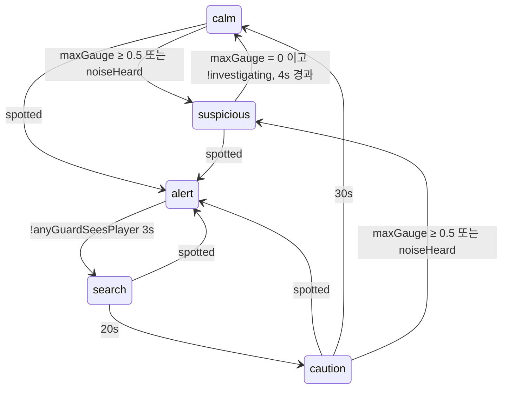

# 상세 설계서 — 계약(Contract)

| 항목 | 내용 |
|---|---|
| 문서 버전 | v1.0 (2026-10-18) |
| 작성 | 리드 |
| 관련 | [02_기본설계서](02_기본설계서.md) (구조·담당 범위), [01_요구사항정의서](01_요구사항정의서.md) (AC), [05_레벨설계서](05_레벨설계서.md) (콘텐츠) |

> 이 문서의 타입·시그니처는 `src/types/*.ts`에 그대로 코드로 존재한다. **코드가 정본**이고, 이 문서는 설명이다.
> 계약을 바꿀 때는 리드가 `src/types`와 이 문서를 함께 고친다.

---

## 1. 좌표·단위 규칙

| 항목 | 규칙 |
|---|---|
| 타일 좌표 `TilePos` | `{ tx, ty }` 정수, 맵 좌상단 (0,0) |
| 월드 좌표 `Vec2` | `{ x, y }` 픽셀. 타일 중심 = `tx*32+16` |
| 방향 `Facing` | `'up' \| 'down' \| 'left' \| 'right'` (스프라이트용) |
| 각도 | 라디안, 0 = 오른쪽(+x), 시계 방향 양수(화면 y가 아래로 증가) |
| 시간 | core 함수의 `dt`는 **초** 단위 |
| 거리 | 데이터·조정값은 **타일** 단위, core 내부는 픽셀로 변환해 계산 |

---

## 2. 공유 타입 (`src/types/`)

### 2.1 단서 `clue.ts`
```ts
export type ClueId = string;                     // 'C1-01' 형식
export type ClueKind = 'person' | 'document' | 'item';
export interface ClueDef {
  id: ClueId;
  name: string;            // [단서 필요: name] 에 쓰임
  kind: ClueKind;          // 수첩 탭
  description: string;
  source: string;          // "미오에게서 / 블루 앵커 카운터"
  carryOver?: boolean;     // 레벨 클리어 시 이월 (AC-24)
  optional?: boolean;      // 등급 단서 수집률 계산에는 포함, 클리어 필수 아님
}
export interface ClueCombo { a: ClueId; b: ClueId; result: ClueId } // 순서 무관 (AC-23)
```

### 2.2 능력 `ability.ts`
```ts
export type AbilityId = 'move' | 'talk' | 'crouch' | 'hide' | 'lockpick' | 'coin';
export interface AbilityDef { id: AbilityId; name: string; description: string; keyHint: string; level: 1 | 2 | 3 }
```
해금 규칙: 레벨 N을 시작하면 `level <= N`인 능력이 모두 사용 가능하다. 사용 불가 능력의 키는 무시한다.

### 2.3 대화 `dialogue.ts`
```ts
export interface Condition {               // 모든 항목 AND
  clues?: ClueId[]; notClues?: ClueId[];
  flags?: string[]; notFlags?: string[];
}
export type Effect =
  | { type: 'giveClue'; clue: ClueId }
  | { type: 'setFlag'; flag: string }
  | { type: 'giveCoins'; amount: number }
  | { type: 'completeObjective'; objective: string }
  | { type: 'excuseAccepted' }              // L2 검문 무마 (AC-40)
  | { type: 'triggerAlarm' }                // 금고 3회 오답 등
  | { type: 'endLevel' };                   // L1 접선 성공 등

export interface Choice {
  text: string;
  next: string;                 // 노드 id
  requires?: ClueId[];          // 미충족 → 회색 + [단서 필요: X] (AC-15)
  showIf?: Condition;           // 미충족 → 아예 숨김(스포일러 방지)
  effects?: Effect[];
}
export interface DialogueNode {
  id: string;
  speaker: string;              // CharacterId | 'player' | 'narrator'
  text: string;
  summaryText?: string;         // 재방문 시 짧은 대사 (AC-19)
  effects?: Effect[];           // 노드 진입 시 적용
  next?: string;                // 선형 진행
  choices?: Choice[];
  present?: {                   // 단서 제시 요청 (AC-17)
    accept: ClueId[]; success: string; wrong: string;  // wrong 노드는 보통 present 노드로 되돌아옴
    cancel?: string;
  };
  codeInput?: {                 // 금고 번호 입력
    answer: string; success: string; wrong: string; maxWrong: number; onMaxWrong: string;
  };
  // next/choices/present/codeInput 이 모두 없으면 대화 종료
}
export interface Dialogue {
  id: string;
  entries: { when?: Condition; node: string }[];   // 위에서부터 첫 매칭 노드로 시작
  nodes: Record<string, DialogueNode>;
}
```

### 2.4 레벨 `level.ts`
```ts
export type LevelId = 1 | 2 | 3;
export interface TilePos { tx: number; ty: number }
export interface TileRect { tx: number; ty: number; w: number; h: number }

export interface TileLegendEntry {
  frame: number;          // 타일셋 프레임 인덱스
  solid: boolean;         // 이동 충돌
  opaque: boolean;        // 시야 차단
  deco?: number;          // 위 레이어 장식 프레임(선택)
}
export interface MapDef {
  tileset: string;                       // public/assets/tiles/<tileset>.png 키
  rows: string[];                        // ASCII, 모든 행 길이 동일 = width
  legend: Record<string, TileLegendEntry>;
}

export type GuardKind = 'static' | 'rotate' | 'patrol';
export interface GuardDef {
  id: string; character: CharacterId; kind: GuardKind;
  pos: TilePos; facingDeg: number;
  rotate?: { anglesDeg: number[]; holdSec: number };    // static/rotate: 순서대로 바라봄
  patrol?: { waypoints: TilePos[]; waitSec: number };   // 순환
  blink?: { everySec: number; closedSec: number };      // L3 브루노 하품 (C3-05)
  catchLine?: string;
}
export interface NpcDef { id: string; character: CharacterId; pos: TilePos; facing: Facing; dialogue: string }

export type InteractableKind = 'inspect' | 'hide' | 'lockedDoor' | 'coinPickup' | 'exit';
export interface InteractableDef {
  id: string; kind: InteractableKind; pos: TilePos;
  dialogue?: string;                 // inspect, safe(금고) 등은 대화로 처리
  pins?: number;                     // lockedDoor
  opensWithClue?: ClueId;            // lockedDoor 를 바로 여는 단서 (C3-03)
  revealedBy?: ClueId;               // 단서 획득 전엔 숨김 (비상 통로)
  requires?: ClueId[];               // exit: 없으면 blockedText (AC-60)
  blockedText?: string;
}
export interface ObjectiveDef { id: string; text: string }
export interface CheckpointDef { id: string; area: TileRect; spawn: TilePos }
export interface ZoneDef { id: string; kind: 'guest' | 'staff'; area: TileRect; label: string }

export interface LevelDef {
  id: LevelId; title: string; subtitle: string; targetTimeSec: number;
  guardsActive: boolean;                         // L1 = false (AC-13, AC-59)
  briefing: { dialogue: string; objectivesPreview: string[]; startClues: ClueId[] };
  map: MapDef;
  player: { spawn: TilePos; facing: Facing; character: CharacterId };
  npcs: NpcDef[]; guards: GuardDef[]; interactables: InteractableDef[];
  clues: ClueDef[]; combos: ClueCombo[];
  objectives: ObjectiveDef[];                    // 순서대로 진행
  checkpoints: CheckpointDef[];
  zones: ZoneDef[];
  dialogues: Dialogue[];
}
```

### 2.5 캐릭터 `character.ts`
```ts
export type CharacterId = string;               // 'moth_l1', 'pepper', 'guard_l2_a' …
export interface CharacterDef {
  id: CharacterId; name: string;
  sheet: string;                 // public/assets/characters/<sheet>.png
  signatureColor: string;        // 초상 배경 '#RRGGBB'
}
```
**스프라이트 시트 규격**: 프레임 64×64, **4행 × 9열** (행 순서 up, left, down, right / 열 0 = 정지, 1~8 = 걷기). LPC 표준 시트의 걷기 행(8~11행)을 잘라낸 것이다. 초상은 `down` 정지 프레임의 머리(상단 32×32)를 2배 확대해 런타임에 만든다.

### 2.6 저장 `save.ts`
```ts
export type Grade = 'S' | 'A' | 'B' | 'C';
export interface Settings { volume: number; textSpeed: 'slow' | 'normal' | 'fast' | 'instant'; highContrast: boolean; reduceFlash: boolean }
export interface SaveData {
  version: 1;
  unlockedLevel: LevelId;
  bestGrade: Partial<Record<LevelId, Grade>>;
  carriedClues: ClueId[];
  settings: Settings;
}
export interface CheckpointData {
  version: 1; level: LevelId; checkpointId: string;
  clues: ClueId[]; flags: string[]; objectivesDone: string[];
  coins: number; coinsUsed: number; usedExcuseGuards: string[];
  visitedNodes: string[]; alertCount: number; elapsedSec: number; openedDoors: string[];
}
```

### 2.7 이벤트 `events.ts` (state/events.ts 의 EventBus 페이로드)
| 이벤트 | 페이로드 | 발신 → 수신 |
|---|---|---|
| `clue:added` | `{ clue: ClueDef }` | Session → HUD(토스트·배지) |
| `objective:changed` | `{ current: ObjectiveDef \| null; completed?: ObjectiveDef }` | Session → HUD |
| `alert:changed` | `{ state: AlertState; prev: AlertState }` | Level → HUD |
| `exposure:changed` | `{ exposure: 'hidden' \| 'safe' \| 'exposed' }` | Level → HUD |
| `coins:changed` | `{ coins: number }` | Session → HUD |
| `toast` | `{ kind: 'clue' \| 'objective' \| 'info' \| 'warn'; text: string }` | 누구나 → HUD |
| `checkpoint:saved` | `{ id: string }` | Level → HUD |
| `player:caught` | `{ by: string }` | Level → Level(재시작 연출) |
| `level:complete` | `{ stats: LevelStats }` | Level → Result |

---

## 3. core 모듈 API (`src/core/`, Phaser import 금지)

### 3.1 `grid.ts`
```ts
export interface Grid { width: number; height: number; isSolid(tx, ty): boolean; isOpaque(tx, ty): boolean }
export function gridFromMap(map: MapDef, extraSolid?: TilePos[]): Grid;   // 범위 밖 = solid & opaque
export function worldToTile(p: Vec2): TilePos;  export function tileCenter(t: TilePos): Vec2;
```

### 3.2 `vision.ts`
```ts
export interface ConeParams { fovDeg: number; nearTiles: number; midTiles: number; farTiles: number }
export type ConeZone = 'none' | 'near' | 'mid' | 'far';
export function hasLineOfSight(grid: Grid, a: Vec2, b: Vec2): boolean;           // 그리드 DDA, 끝점 타일은 무시
export function classifyTarget(grid, origin: Vec2, facingRad: number, p: ConeParams, target: Vec2): ConeZone;
export function castCone(grid, origin, facingRad, p: ConeParams, rays: number): Vec2[]; // 원뿔 폴리곤 [origin, ...끝점]
```
- 구역 경계: near `0~nearTiles`, mid `~midTiles`, far `~farTiles` (기본 2.5 / 5 / 7, 주의 상태면 far+1).
- 각도 밖이거나 LOS 막힘 → `'none'`.

### 3.3 `detection.ts`
```ts
export interface DetectionInput { zone: ConeZone; crouched: boolean; hidden: boolean }
export function fillTimeSec(i: DetectionInput): number | null;     // null = 감지 안 됨
export function updateGauge(gauge: number, dt: number, i: DetectionInput): number;  // 0..1 클램프
```
| 구역 | 서기 | 웅크리기 |
|---|---|---|
| near | 0.4s | 0.4s |
| mid | 1.0s | 2.0s |
| far | 1.6s | 감지 없음 |
| none / hidden | 감소 40%/s | 감소 40%/s |

### 3.4 `alert.ts` — 레벨 전역 경보 상태 머신 (AC-32~35)
```ts
export type AlertState = 'calm' | 'suspicious' | 'alert' | 'search' | 'caution';
export interface AlertInput { maxGauge: number; spotted: boolean; anyGuardSeesPlayer: boolean; investigating: boolean; noiseHeard: boolean }
export class AlertMachine {
  state: AlertState; timeInState: number; alertCount: number;
  constructor(timings?: Partial<AlertTimings>);
  update(dt: number, i: AlertInput): AlertState;   // 상태 반환
  forceAlert(): void;                             // 무음 경보(AC-61), 3회 오답
  reset(): void;                                  // 체크포인트 복귀 → calm (alertCount 유지)
}
```

`alert` 진입 시마다 `alertCount += 1`.

### 3.5 `dialogue.ts`
```ts
export interface DialogueContext { hasClue(id: ClueId): boolean; hasFlag(f: string): boolean; isVisited(nodeId: string): boolean }
export interface ChoiceView { index: number; text: string; locked: boolean; missing: ClueId[]; visited: boolean }
export type DialogueMode = 'line' | 'choice' | 'present' | 'code' | 'end';
export interface DialogueView { nodeId: string; speaker: string; text: string; mode: DialogueMode; choices: ChoiceView[] }
export class DialogueRunner {
  constructor(dialogue: Dialogue, ctx: DialogueContext);
  start(): DialogueView;                 // entries 첫 매칭. 매칭 없으면 Error
  advance(): DialogueView;               // mode 'line' 에서만
  choose(index: number): DialogueView;   // 잠긴 선택지는 무시하고 현재 view 반환
  present(clue: ClueId): DialogueView;   // mode 'present'
  submitCode(code: string): DialogueView;// mode 'code'
  drainEffects(): Effect[];              // 누적 효과를 꺼내고 비움
  visitedNodes(): string[];              // 이번 대화에서 방문한 노드
}
export function validateDialogue(d: Dialogue, knownClues: ClueId[]): string[];  // 오류 메시지 목록 (AC-18)
```
- 노드 진입 시 `isVisited(id) && summaryText` 이면 `text` 대신 `summaryText`.
- `showIf` 미충족 선택지는 `choices`에서 제외하되 `index`는 원본 배열 인덱스를 유지.

### 3.6 `clues.ts`
```ts
export class ClueBook {
  constructor(defs: ClueDef[], initial?: ClueId[]);
  add(id: ClueId): boolean;              // 새로 얻으면 true, 중복이면 false (AC-22)
  has(id: ClueId): boolean; list(): ClueDef[]; ids(): ClueId[];
  combine(a: ClueId, b: ClueId, combos: ClueCombo[]): ClueId | null;  // 성공 시 결과 add 까지 수행
}
```

### 3.7 `pathfinding.ts`
```ts
export function findPath(grid: Grid, from: TilePos, to: TilePos, maxNodes?: number): TilePos[] | null; // 4방향, from 제외 to 포함
```

### 3.8 `lockpick.ts` (AC-42~45)
```ts
export class LockpickGame {
  constructor(opts: { pins: number; periodSec?: number; zoneRatio?: number; rng?: () => number });
  readonly pins: number; pinsSet: number; cursor: number /*0..1*/; zoneStart: number; zoneRatio: number;
  update(dt: number): void;                       // 커서 왕복(삼각파)
  press(): 'hit' | 'miss' | 'done';               // miss → pinsSet = 0, zone 재배치
}
```

### 3.9 `noise.ts`
```ts
export function guardsInRadius<T extends { id: string; pos: Vec2 }>(guards: T[], origin: Vec2, radiusTiles: number): T[];
export function coinTarget(grid: Grid, from: Vec2, aim: Vec2, maxTiles: number): { point: Vec2; valid: boolean };
// 최대 거리로 자르고, LOS가 막히면 valid=false
```

### 3.10 `grade.ts` (AC-56~58)
```ts
export interface LevelStats { level: LevelId; timeSec: number; alertCount: number; cluesFound: number; cluesTotal: number; coinsUsed: number; checkpointRestarts: number }
export function computeGrade(s: LevelStats, targetTimeSec: number): Grade;
export function betterGrade(a: Grade | undefined, b: Grade): boolean;  // b가 더 좋으면 true
```
L1(`guardsActive=false`)은 경보 조건을 무시한다: S = 단서 100% + 시간 이내, A = 단서 80%+, B = 단서 50%+, C = 그 외.

### 3.11 `save.ts`
```ts
export interface StorageLike { getItem(k: string): string | null; setItem(k: string, v: string): void; removeItem(k: string): void }
export const SAVE_KEY = 'spyGame.save.v1', BACKUP_KEY = 'spyGame.save.v1.bak', CHECKPOINT_KEY = 'spyGame.checkpoint.v1';
export function defaultSave(): SaveData;
export class SaveStore {
  constructor(storage: StorageLike | null);       // null = 접근 불가 → 메모리 모드
  readonly available: boolean;                    // false 면 HUD 경고 (AC-55)
  load(): { data: SaveData; notice?: 'reset' | 'restoredFromBackup' };  // AC-54
  save(d: SaveData): void;                        // 저장 전 기존 값을 BACKUP_KEY 로 복사
  loadCheckpoint(): CheckpointData | null; saveCheckpoint(c: CheckpointData): void; clearCheckpoint(): void;
}
export function applyLevelClear(d: SaveData, level: LevelId, grade: Grade, carried: ClueId[]): { data: SaveData; newBest: boolean };
```
- 검증 실패(파싱 오류, `version !== 1`, 필드 타입 불일치) → 손상본을 `spyGame.save.corrupt.<epoch>` 로 옮기고 백업 시도 → 실패 시 `defaultSave()`.
- 모든 storage 호출은 try/catch. 예외가 나면 메모리 모드로 전환.

---

## 4. 조정값 (`src/config.ts` 의 `TUNING`)

| 키 | 기본값 | 근거 |
|---|---|---|
| `walkSpeed` / `crouchSpeed` | 120 / 60 px/s | AC-09 |
| `interactRangeTiles` | 1.5 | AC-12 |
| `cone` | fov 70°, near 2.5, mid 5, far 7, rays 32, cautionBonus 1 | AC-25·26·35 |
| `gaugeDecayPerSec` | 0.4 | AC-28 |
| `alert` | suspiciousClear 4s, lostSight 3s, search 20s, caution 30s, alertSpeedMul 1.5 | AC-33·34 |
| `catchRangeTiles` | 0.75 | AC-36 |
| `hideTransitionSec` | 0.3 | AC-39 |
| `lockpick` | period 1.2s, zone 0.18, noise 6 tiles | AC-43·44 |
| `coin` | maxTiles 8, noiseTiles 5, investigateSec 4, max 5 | AC-46~48 |
| `search` | radiusTiles 5, points 3 | AC-34 |
| `fadeSec` | 0.5 | AC-02 |

---

## 5. 입력 바인딩 (`src/input/bindings.ts`)
```ts
export type Action = 'up' | 'down' | 'left' | 'right' | 'interact' | 'crouchToggle' | 'crouchHold'
  | 'notebook' | 'pause' | 'advance' | 'coinAim' | 'lockpickPress' | 'log' | 'choice1' | 'choice2' | 'choice3' | 'choice4';
export const BINDINGS: Record<Action, string[]>;  // Phaser KeyCode 이름: up=['W','UP'] …
```
기본값은 01 §7 표와 같다. `crouchHold = ['SHIFT']`, `coinAim = ['G']`.

---

## 6. 저장 형식 예시
```json
{
  "version": 1,
  "unlockedLevel": 2,
  "bestGrade": { "1": "A" },
  "carriedClues": ["C1-05", "C1-06"],
  "settings": { "volume": 0.8, "textSpeed": "normal", "highContrast": false, "reduceFlash": false }
}
```

---

## 7. 테스트 API (`src/debug/testApi.ts`)
개발 서버이거나 URL에 `?test=1`이 있을 때만 `window.__spy`를 노출한다(프로덕션 빌드 기본값에서는 노출하지 않음).
```ts
interface SpyTestApi {
  scene(): string;                                  // 현재 활성 메인 씬 키
  state(): { level?: LevelId; clues: ClueId[]; flags: string[]; objective?: string; alert?: AlertState; coins?: number; phase?: string };
  goto(scene: 'Title' | 'LevelSelect' | 'Briefing' | 'Level' | 'Result', data?: object): void;
  teleport(tx: number, ty: number): void;
  giveClue(id: ClueId): void;
  interact(): void;                                 // E 와 동일
  dialogue(): DialogueView | null;                  // 열린 대화
  choose(index: number): void; advance(): void; present(id: ClueId): void;
  save(): SaveData;
}
```

---

## 8. 타일·캐릭터 ID 계약 (`src/types/tiles.ts`, `src/data/tiles.ts`)

- 맵은 **공통 ASCII 문자표** `TILE_CHARS`로 쓴다. 문자 → 의미 이름(`TileName`) → 충돌·시야 속성(`TILE_TRAITS`, 고정).

| 문자 | 타일 | solid | opaque | 문자 | 타일 | solid | opaque |
|---|---|---|---|---|---|---|---|
| (공백) | void | ✓ | ✓ | `=` | counter | ✓ | |
| `#` | wall | ✓ | ✓ | `T` | table | ✓ | |
| `W` | wallWindow | ✓ | ✓ | `h` | chair | | |
| `.` | floorWood | | | `B` | shelf | ✓ | ✓ |
| `,` | floorTile | | | `P` | plant | ✓ | ✓ |
| `;` | floorConcrete | | | `H` | hedge | ✓ | |
| `_` | carpet | | | `C` | crate | ✓ | ✓ |
| `"` | grass | | | `M` | machine | ✓ | ✓ |
| `-` | dock | | | `K` | locker | ✓ | ✓ |
| `~` | water | ✓ | | `d` | desk | ✓ | |
| `D` | door | | | `S` | safe | ✓ | ✓ |
| | | | | `E` | elevator | | |

- 은신처·잠긴 문·출구 등 상호작용 대상은 맵 문자가 아니라 `interactables`로 배치한다(바닥 문자 위에 놓임). 잠긴 문은 열리기 전까지 해당 타일을 solid로 취급한다(`gridFromMap(map, extraSolid)`).
- 레벨 타일셋: `tiles_l1`, `tiles_l2`, `tiles_l3` (`public/assets/tiles/<key>.png`, 32px 프레임 격자). 각 `TileName`의 프레임 번호는 에셋 담당이 `src/data/tiles.ts`의 `TILE_FRAMES`에 채운다. 레벨 데이터는 `buildLegend(tileset)`만 호출한다.
- 캐릭터 ID는 `CHARACTER_IDS`(22종)로 고정한다. 에셋 담당이 `src/data/characters.ts`에 `CharacterDef`를 만들고 `public/assets/characters/<id>.png`를 생성한다.
